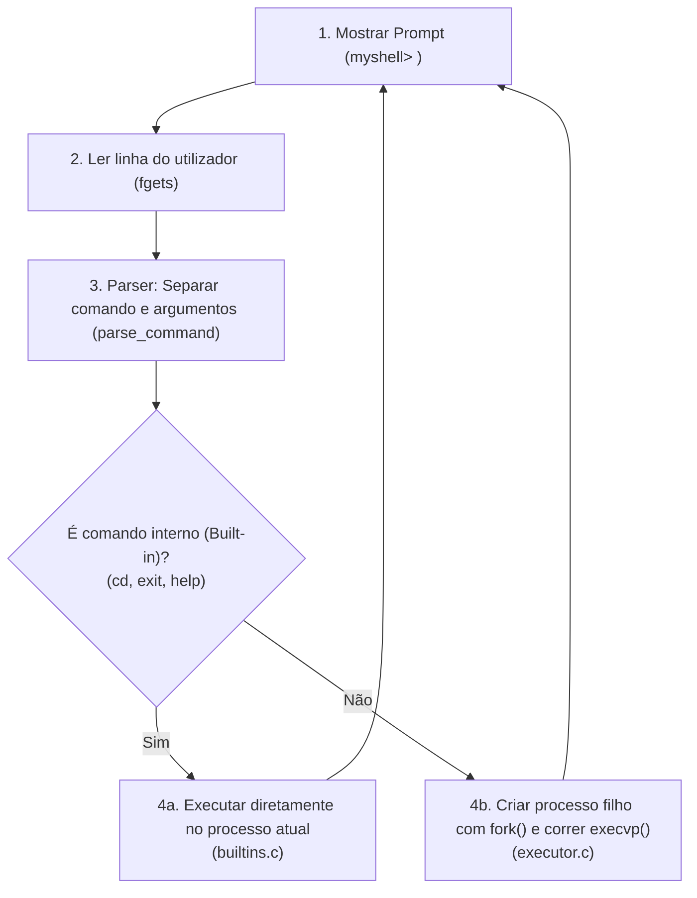

# 🐚 Guia de Arquitetura e Divisão do Trabalho — MiniShell (AHSO)

Este documento explica como a nossa **MiniShell** funciona passo a passo, o que cada ficheiro deve conter e como podemos dividir o trabalho entre o grupo sem conflitos.

---

## 1. Visão Geral: Como funciona uma Shell?

Uma shell interativa funciona num ciclo infinito (**REPL**: *Read → Parse → Execute → Loop*):



---

## 2. O que fica em cada ficheiro?

Para seguirmos a estrutura recomendada no enunciado (`TodoOnMyShellProject.md`), dividimos o projeto em **4 módulos**:

```text
MyShellProject/
├── Makefile          # Receita para compilar tudo com o comando "make"
├── main.c            # Loop principal da shell (mostra prompt e lê a linha)
├── parser.h          # Declaração das funções e estruturas do parser
├── parser.c          # Código que parte a linha lida em palavras/argumentos
├── builtins.h        # Declaração dos comandos internos
├── builtins.c        # Código dos comandos internos (cd, exit, help, clear)
├── executor.h        # Declaração do executor de comandos
└── executor.c        # Código que faz fork(), execvp() e wait()
```

---

### 📄 Módulo 1: `main.c` (O Ciclo Principal)
**Responsabilidade:**
1. Mostrar a prompt `myshell> `.
2. Ler a linha que o utilizador escreveu (usando `fgets`).
3. Passar essa linha ao `parser` para a dividir numa lista de palavras (`args`).
4. Passar o resultado ao `executor` (que decide se é um *built-in* ou comando externo).
5. Repetir até o utilizador escrever `exit` ou `quit` (ou carregar em `Ctrl+D`).

---

### 📄 Módulo 2: `parser.c` e `parser.h` (Separador de Comandos)
**Responsabilidade:**
Transformar uma string única como `"ls -la /home"` num array de strings terminado em `NULL` (que é o formato exigido pelo `execvp`):
```text
args[0] = "ls"
args[1] = "-la"
args[2] = "/home"
args[3] = NULL
```

**Dicas de C para quem fizer o `parser.c`:**
- Remover o `\n` que o `fgets()` deixa no final da string (ex: `linha[strcspn(linha, "\n")] = '\0';`).
- Usar `strtok(linha, " \t")` para partir a string nos espaços.
- Detetar se o último argumento é `"&"` (para comandos em *background* da Parte 2) ou se existem símbolos como `"|"`, `">"` ou `"<"`.

---

### 📄 Módulo 3: `builtins.c` e `builtins.h` (Comandos Internos)
**Porque é que comandos como `cd` e `exit` têm de ser internos (e não usam `fork()`)?**
- Se fizéssemos `fork()` para correr `cd`, o processo **filho** mudaria de diretoria e morreria logo a seguir, deixando a nossa shell (processo **pai**) na mesma diretoria onde estava!
- Por isso, os *built-ins* são funções normais em C executadas diretamente pela própria shell:
  - **`exit` / `quit`**: Termina o ciclo da shell.
  - **`cd [diretoria]`**: Usa a função `chdir(args[1])` da biblioteca `<unistd.h>`. Se `args[1]` for `NULL` (utilizador escreveu só `cd`), usa `getenv("HOME")` para ir para a pasta *Home*.
  - **`help`**: Faz `printf` com a lista de comandos suportados pela shell.
  - **`clear`**: Limpa o ecrã.

---

### 📄 Módulo 4: `executor.c` e `executor.h` (Fork + Exec)
**Responsabilidade:**
Quando o comando **não** é um *built-in* (por exemplo, `ls`, `cat`, `mkdir`, `ps`), a shell tem de pedir ao Sistema Operativo para correr esse programa:

```c
pid_t pid = fork();

if (pid < 0) {
    perror("Erro no fork");
} else if (pid == 0) {
    // --- CÓDIGO DO PROCESSO FILHO ---
    // Substitui o processo filho pelo programa pedido (ex: "ls")
    if (execvp(args[0], args) == -1) {
        fprintf(stderr, "myshell: comando nao encontrado: %s\n", args[0]);
        exit(EXIT_FAILURE);
    }
} else {
    // --- CÓDIGO DO PROCESSO PAI (a nossa Shell) ---
    // Espera que o filho termine (a menos que seja em background com '&')
    waitpid(pid, NULL, 0);
}
```

---

## 3. Como combinar os ficheiros entre o grupo? (O "Contrato")

Para que cada pessoa possa programar o seu ficheiro sem esperar pelos outros, basta acordarmos primeiro os cabeçalhos (`.h`).

Por exemplo, se definirmos desde o início que:
1. Em **`parser.h`**:
   ```c
   int parse_command(char *linha, char **args, int *background);
   ```
2. Em **`builtins.h`**:
   ```c
   // Devolve 1 se era um builtin e foi executado, ou 0 se não era builtin
   int execute_builtin(char **args);
   ```
3. Em **`executor.h`**:
   ```c
   void execute_command(char **args, int background);
   ```

Assim:
- **Pessoa A** pode fazer o `main.c` e o `builtins.c`.
- **Pessoa B** pode fazer o `parser.c`.
- **Pessoa C** pode fazer o `executor.c`.

---

## 4. Boas Práticas de Git para o Grupo

Para ninguém apagar o trabalho de ninguém por acidente:
1. **Antes de começar a programar:** Corre sempre `git pull` para descarregar as últimas alterações dos colegas.
2. **Testar antes de enviar:** Corre `make` para garantir que o código compila sem erros.
3. **Não enviar ficheiros compilados para o GitHub:** Ficheiros `.o` e o executável `myshell` não devem ir para o Git (faz-se `make clean` antes ou adiciona-se um ficheiro `.gitignore`).
4. **Guardar e partilhar alterações:**
   ```bash
   git add .
   git commit -m "Implementado comando cd e help em builtins.c"
   git push
   ```
