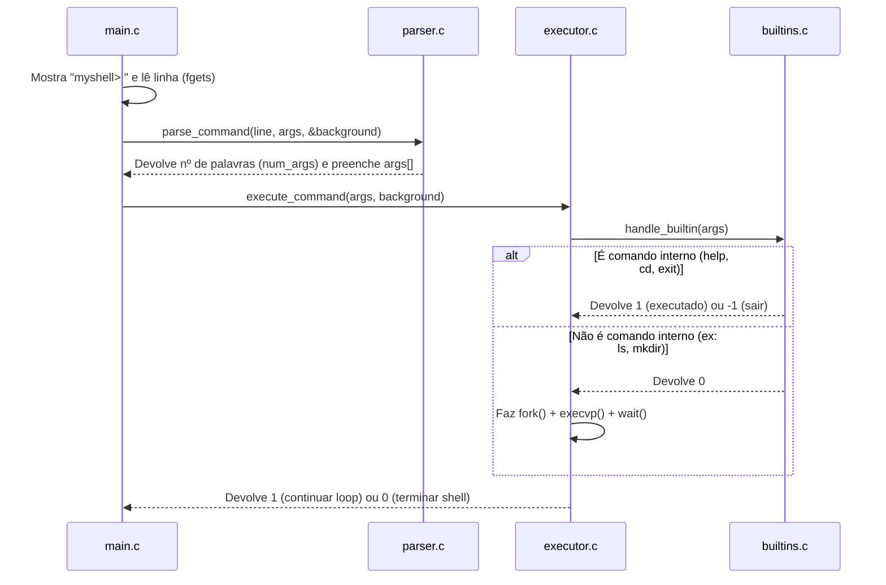

# 📖 Guia Explicativo dos Ficheiros e do Código Atual

Este documento explica, **linha a linha**, todos os ficheiros que existem atualmente no nosso projeto, como comunicam entre si e o que falta preencher nos blocos `// TODO`.

---

## 🔗 Como os Ficheiros Comunicam Entre Si

Quando o programa corre, a ordem das chamadas entre ficheiros é sempre esta:



---

## 1. `main.c` — O Ponto de Entrada e Loop Principal

O `main.c` é o maestro do programa: ele não sabe partir strings nem sabe criar processos com `fork()`, mas chama os módulos que fazem isso.

```c
#include <stdio.h>
#include <stdlib.h>
#include "parser.h"    // Permite chamar parse_command() e usar MAX_LINE / MAX_ARGS
#include "executor.h"  // Permite chamar execute_command()
#include "builtins.h"
```

### Variáveis principais dentro do `main()`:
- **`char line[MAX_LINE];`** — Guarda o texto bruto que o utilizador escreveu no teclado (até 1024 caracteres).
- **`char *args[MAX_ARGS];`** — Um array de apontadores para strings (até 64 palavras). Depois de passar pelo `parser`, `args[0]` será o nome do comando (ex: `"ls"`) e `args[1]`, `args[2]`, etc. serão os argumentos.
- **`int background = 0;`** — Guarda `0` (comando normal) ou `1` (se o comando tinha um `&` no fim para correr em *background*).
- **`int running = 1;`** — Controla o ciclo `while (running)`. Enquanto for `1`, a shell continua a pedir comandos; quando passa a `0` (comando `exit`), o programa termina.

### Passo a passo dentro do `while (running)`:

1. **Mostrar a prompt:**
   ```c
   printf("myshell> ");
   fflush(stdout);
   ```
   - `fflush(stdout)` força o texto `"myshell> "` a aparecer imediatamente no ecrã (mesmo não tendo um `\n` no fim).

2. **Ler o comando do teclado:**
   ```c
   if (fgets(line, sizeof(line), stdin) == NULL) {
       printf("\n");
       break;
   }
   ```
   - `fgets` lê uma linha inteira (incluindo espaços) a partir do teclado (`stdin`).
   - Se devolver `NULL`, significa que o utilizador carregou em **`Ctrl+D`** (*End Of File / EOF*), pelo que fazemos `break` para fechar a shell limpamente.

3. **Chamar o Parser:**
   ```c
   int num_args = parse_command(line, args, &background);
   if (num_args == 0) {
       continue;
   }
   ```
   - Passamos `&background` (o endereço da variável `background`) para que o `parse_command` consiga alterar o valor dela diretamente para `1` se encontrar um `&`.
   - Se `num_args == 0` (o utilizador só carregou em `Enter` numa linha vazia), o `continue` volta ao topo do `while` e mostra a prompt outra vez.

4. **Executar o comando:**
   ```c
   running = execute_command(args, background);
   ```
   - O `execute_command` devolve `1` se for para a shell continuar aberta, ou `0` se o utilizador escreveu `exit` ou `quit`.

---

## 2. `parser.h` e `parser.c` — O Separador de Comandos

### O que está no `parser.h`:
```c
#ifndef PARSER_H
#define PARSER_H

#define MAX_LINE 1024
#define MAX_ARGS 64

int parse_command(char *line, char **args, int *background);

#endif
```
- Define as constantes `MAX_LINE` (tamanho máximo de uma linha) e `MAX_ARGS` (número máximo de palavras num comando).
- Declara a função `parse_command` para que o `main.c` a possa chamar.

### O que está no `parser.c`:
```c
int parse_command(char *line, char **args, int *background) {
    int count = 0;
    *background = 0;

    // Remove o '\n' do final da linha lida pelo fgets
    line[strcspn(line, "\n")] = '\0';

    // TODO: ...
    (void)args;

    return count;
}
```
- **Porque existe `line[strcspn(line, "\n")] = '\0';`?**
  Quando escreves `ls` e carregas em `Enter`, o `fgets` guarda `"ls\n\0"`. A função `strcspn(line, "\n")` encontra a posição do `\n` e substitui-o por `'\0'` (fim de string), ficando apenas `"ls"`.
- **Porque existe `(void)args;`?**
  Enquanto o `TODO` não está preenchido, a variável `args` ainda não está a ser usada. `(void)args;` diz ao compilador: *"eu sei que ainda não usei esta variável, não mostres aviso de unused parameter"*. **Quando implementarem o `TODO`, podem apagar a linha `(void)args;`.**
- **O que falta fazer no `TODO` do `parser.c`:**
  Usar `strtok(line, " \t")` num ciclo `while` para guardar cada palavra em `args[count++]`, verificar se a última palavra é `"&"` (se for, meter `*background = 1` e remover o `"&"` de `args`), e colocar `args[count] = NULL;` no final.

---

## 3. `builtins.h` e `builtins.c` — Comandos Internos da Shell

### O que está no `builtins.h`:
Declara três funções:
- `int handle_builtin(char **args);` — Verifica se o comando digitado é interno.
- `void builtin_help(void);` — Mostra a ajuda no ecrã.
- `void builtin_cd(char **args);` — Muda de diretoria.

### O que está no `builtins.c`:

1. **`builtin_help()`:**
   Já está implementada! Imprime no ecrã a lista de comandos internos da MiniShell.

2. **`builtin_cd(char **args)`:**
   Tem um `TODO` para implementar a mudança de pasta:
   - Se o utilizador escrever apenas `cd` (`args[1] == NULL`), devemos ir buscar a pasta *Home* com `getenv("HOME")` e passar a `chdir()`.
   - Se o utilizador escrever `cd pasta` (`args[1] != NULL`), fazemos `chdir(args[1])` (incluindo `#include <unistd.h>` no topo) e mostramos erro com `perror("cd")` se devolver `-1`.

3. **`handle_builtin(char **args)`:**
   Compara a primeira palavra do comando (`args[0]`) usando `strcmp()`:
   - Se for `"exit"` ou `"quit"` → devolve **`-1`** (código especial que avisa o `executor.c` que é hora de fechar a shell).
   - Se for `"help"` → chama `builtin_help()` e devolve **`1`** (comando interno tratado).
   - Se for `"cd"` → chama `builtin_cd(args)` e devolve **`1`** (comando interno tratado).
   - Se não for nenhum destes → devolve **`0`** (significa que é um comando externo do Linux, como `ls`, `cat`, `ps`, `grep`, etc.).

---

## 4. `executor.h` e `executor.c` — O Executor de Comandos

### O que está no `executor.h`:
Declara a função `int execute_command(char **args, int background);`.

### O que está no `executor.c`:
```c
int execute_command(char **args, int background) {
    if (args[0] == NULL) {
        return 1; // Linha vazia, continua a shell
    }

    // 1. Verificar se e um comando interno (built-in)
    int builtin_status = handle_builtin(args);
    if (builtin_status == -1) {
        return 0; // Comando exit/quit: terminar a shell
    }
    if (builtin_status == 1) {
        return 1; // Built-in executado com sucesso, continuar a shell
    }

    // 2. Comando externo do SO (fork + execvp + wait)
    // TODO: ...
    (void)background;

    return 1;
}
```
- **Passo 1 (já implementado):** Antes de tentar criar processos no sistema operativo, pergunta ao `handle_builtin(args)` se o comando é interno:
  - Se `handle_builtin` devolver `-1` (`exit`/`quit`), `execute_command` devolve `0`, o que faz `running = 0` no `main.c` e fecha a shell.
  - Se `handle_builtin` devolver `1` (`help`/`cd`), o comando já foi executado, logo devolve `1` para a shell pedir o próximo comando.
- **Passo 2 (`TODO` a implementar):** Se chegou aqui, `builtin_status` foi `0` (não é *built-in*). Aqui entra a criação de processos:
  - Incluir `<unistd.h>` e `<sys/wait.h>`.
  - Chamar `pid_t pid = fork();`.
  - No processo filho (`pid == 0`), correr `execvp(args[0], args)`. Se der erro, mostrar mensagem de comando não encontrado e fazer `exit(EXIT_FAILURE)`.
  - No processo pai (`pid > 0`), se `background == 0`, esperar que o filho termine com `waitpid(pid, NULL, 0)`.

---

## 5. `Makefile` — A Compilação Automática

```makefile
CC = gcc
CFLAGS = -Wall -Wextra -g -std=gnu11
TARGET = MyShellProject
SRCS = main.c parser.c executor.c builtins.c
OBJS = $(SRCS:.c=.o)

$(TARGET): $(OBJS)
	$(CC) $(CFLAGS) -o $@ $^

$(OBJS): %.o: %.c
	$(CC) $(CFLAGS) -c $< -o $@

.PHONY: clean
clean:
	rm -f $(OBJS) $(TARGET)
```

- **`SRCS = main.c parser.c executor.c builtins.c`**: Lista todos os 4 ficheiros `.c` do projeto.
- **`OBJS = $(SRCS:.c=.o)`**: Transforma automaticamente a lista de `.c` em `main.o parser.o executor.o builtins.o`.
- **`$(TARGET): $(OBJS)`**: Junta todos os `.o` num único programa executável chamado `MyShellProject`.
- **`$(OBJS): %.o: %.c`**: Compila cada `.c` individualmente num ficheiro `.o`.
- **`clean`**: Permite escrever `make clean` para apagar os `.o` e o executável `MyShellProject`.
